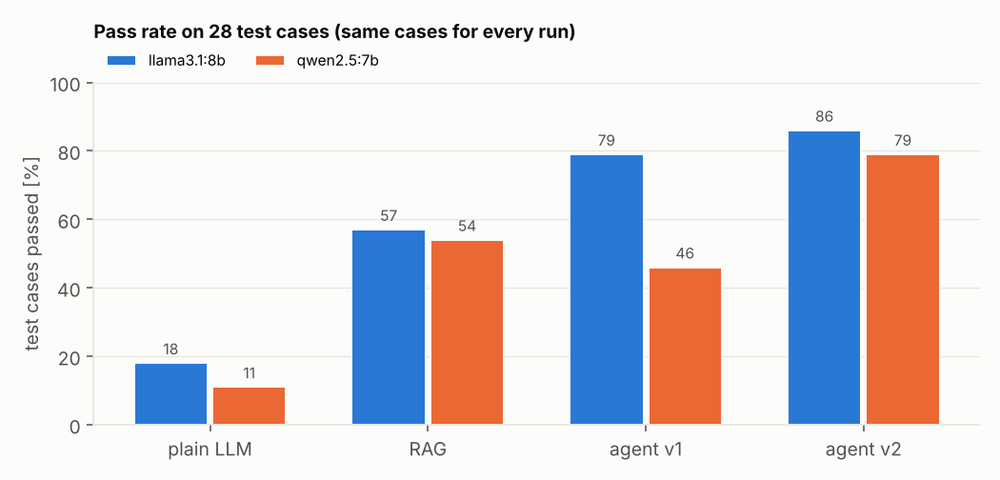
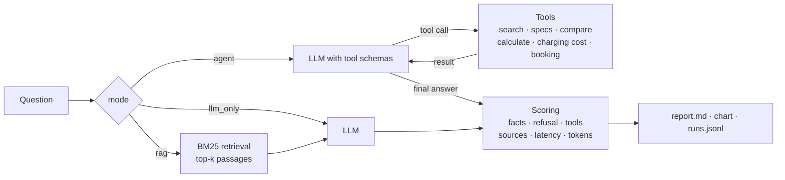

# agent-eval-lab

**Build and evaluate tool-using LLM agents against RAG and plain-LLM baselines.**

[](https://github.com/sandraesudhakaran-creator/agent-eval-lab/actions/workflows/ci.yml)
[](https://colab.research.google.com/github/sandraesudhakaran-creator/agent-eval-lab/blob/main/notebooks/colab_walkthrough.ipynb)

Before an AI use case goes live, someone has to answer a simple question: does the more complex setup actually work better, and at what cost? This project answers it in a measurable way. It runs the same test questions through three configurations and scores every answer:

| mode | what the model gets |
|---|---|
| `llm_only` | only the question |
| `rag` | the question plus the most relevant document passages (retrieval-augmented generation) |
| `agent` | the question plus tools it decides to call itself: document search, product data lookup, comparison, calculator, charging-cost estimate and a booking action |

Any model that speaks the OpenAI chat format can be plugged in:
- open models on a free Colab GPU via **Ollama**
- **Groq**, **OpenAI** or **Gemini**
- any other OpenAI-compatible endpoint

The demo domain is a customer assistant for **Velora Motors, a fictional electric-car maker**. It has six policy documents and a product table, all invented for this project. The domain is only a test bed: the agent, tools and evaluation work with any document folder and any set of Python functions.

## What it shows

- **An agent written from scratch, without a framework.** About 100 lines implement the full tool-calling loop:
  - the model requests tools, the code runs them and feeds the results back
  - a step limit, then a final answer without tools
  - every model call and tool call is recorded with latency and tokens
- **Tools from plain Python functions.** JSON schemas are generated from type hints and docstrings. Tool errors are returned to the model as text, so it can correct itself instead of crashing.
- **Retrieval.** Markdown is chunked along its headings, then ranked with BM25. This is explainable and needs no model download; a vector retriever can replace it through the same interface.
- **Evaluation harness.** 28 test cases in 7 categories:
  - document lookup
  - product data
  - comparison
  - calculation
  - multi-step questions that combine documents, data and maths
  - actions
  - questions that cannot be answered from the data, to catch hallucinations
- **Transparent scoring.** Every failed case lists the reason. The scores cover:
  - expected facts and forbidden content
  - correct refusals
  - tool recall and tool precision, and the correctness of action arguments
  - source recall
  - latency and token cost

  An optional LLM-as-judge adds a second opinion.
- **Robustness for small models.** The agent handles several ways small models go wrong:
  - a tool call written as JSON text instead of the native tool field is recovered
  - arguments with the wrong type are converted
  - the agent gets one reminder when it answers without checking anything
  - rate limits are retried with back-off
  - an unreachable model server stops the run immediately with a clear message

## Results

Two open models ran on a free Colab T4 GPU through Ollama: **Llama 3.1 8B** and **Qwen 2.5 7B**. Every run used the same 28 test cases, temperature 0, and the same prompts and tools.

<p align="center"></p>

| model | mode | pass rate | tool recall | tool precision | refusal accuracy | mean latency | mean tokens |
|---|---|---:|---:|---:|---:|---:|---:|
| llama3.1:8b | plain LLM | 18 % | – | – | 33 % | 3.5 s | 156 |
| llama3.1:8b | RAG | 57 % | – | – | 100 % | 1.0 s | 379 |
| llama3.1:8b | agent v1 | 79 % | 0.90 | 1.00 | 67 % | 2.9 s | 1,351 |
| llama3.1:8b | **agent v2** | **86 %** | 0.90 | 1.00 | 67 % | 2.9 s | 1,397 |
| qwen2.5:7b | plain LLM | 11 % | – | – | 67 % | 1.4 s | 162 |
| qwen2.5:7b | RAG | 54 % | – | – | 100 % | 1.5 s | 408 |
| qwen2.5:7b | agent v1 | 46 % | 0.44 | 0.54 | 100 % | 2.4 s | 1,655 |
| qwen2.5:7b | **agent v2** | **79 %** | 0.88 | 1.00 | 67 % | 3.8 s | 2,792 |

Pass rate by category:

| run | doc lookup | spec lookup | comparison | calculation | multi-step | action | unanswerable |
|---|---:|---:|---:|---:|---:|---:|---:|
| llama3.1:8b / RAG | 100 % | 0 % | 0 % | 60 % | 0 % | 0 % | 100 % |
| llama3.1:8b / agent v2 | 100 % | 100 % | 100 % | 80 % | 0 % | 100 % | 67 % |
| qwen2.5:7b / RAG | 100 % | 0 % | 0 % | 40 % | 0 % | 0 % | 100 % |
| qwen2.5:7b / agent v2 | 100 % | 100 % | 67 % | 80 % | 0 % | 50 % | 67 % |

### What the results show

- **Without company data, both models mostly guess.** They pass 11–18 % of the cases and invent prices and figures, for example an acceleration time for a car whose data contains none.
- **RAG solves the document questions** (100 %) and is the cheapest setup: about 400 tokens per question. It cannot answer questions that need the product table, exact arithmetic or an action.
- **The agent is the strongest setup** at 86 % with Llama, but it costs 3.7× (Llama) to 6.8× (Qwen) more tokens per question than RAG. Whether that is worth it depends on how many questions need data, calculations or actions.
- **The agent also hallucinates more on unanswerable questions.** Its refusal accuracy is 67 %, against 100 % for RAG. With tools available, the models feel encouraged to produce an answer. In one case Llama invented "4.8 seconds" and cited a tool result that contains no acceleration value.
- **Both models fail the two multi-step price questions** (car price plus an accessory from the documents). They either mix up the leasing rate with the purchase price or stop after the first lookup.

### Iteration: from v1 to v2

Reading the step-by-step traces of the failed v1 cases (`runs.jsonl`) showed five patterns. Most of them were problems with the tool design, not with the models:

| v1 failure seen in the traces | v2 change |
|---|---|
| Qwen wrote "Let me search the documents…" and stopped without calling a tool (7 cases) | One reminder if the agent answers without having used any tool |
| `compare_models` was called with invented names such as `towing_capacity` | The allowed attribute names are now an enum in the tool schema |
| Numbers were sent as text (`"20"`, `"0.25"`) and the tool crashed | Arguments are converted to the types in the schema |
| Models invented an electricity price instead of using the default | The parameter description says when to leave it out |
| A wrong argument name made the model give up | The error message now shows an example of a correct call |

The test cases were not changed between v1 and v2. **Qwen improved from 46 % to 79 % (13 → 22 cases)**, mainly through the reminder: document questions went from 30 % to 100 %. **Llama went from 79 % to 86 % (22 → 24 cases)**, a difference of two cases, which is within the noise of a set this small.

Caveat: the v2 changes were designed after looking at failures on this same test set. The fixes are generic (schemas, type handling, a reminder), but a new, held-out set of questions would be needed to confirm the gain without bias.

### Baseline without an LLM

CI runs this baseline on every push. The extractive baseline returns the best-matching passage:

| run | pass rate | what it shows |
|---|---:|---|
| baseline, `llm_only` | 11 % (3/28) | Always says it doesn't know, so only the 3 unanswerable cases pass |
| baseline, `rag` | 39 % (11/28) | Retrieval alone answers all 10 document questions and nothing else |

## How it works



**The agent loop** (`src/agentlab/agent.py`):
1. Send the conversation and the tool schemas to the model.
2. If the model asks for tools, run them and append each result as a `tool` message. Go back to step 1.
3. When the model answers without a tool call, that is the result.
4. After `max_steps` rounds, ask the model once more, without tools, to answer with what it has.

**Scoring** (`src/agentlab/evaluation.py`):
- **Answerable cases** pass when all expected facts appear in the answer, nothing forbidden appears, action arguments match and no error occurred. Numbers match regardless of formatting, so 1,190 = 1.190 = 1190.
- **Unanswerable cases** pass only when the answer says the information isn't available and invents nothing.

Rules were chosen over an LLM judge as the primary metric because they are reproducible and every verdict can be traced to a reason.

## Quick start

```bash
pip install -e ".[dev]"

# no LLM needed
agentlab eval --provider extractive --out outputs/baseline

# local open model (Ollama running, model pulled)
agentlab ask "What does it cost to charge a Ridge from 20 to 80 %?" --model qwen2.5:7b --trace
agentlab eval --model qwen2.5:7b --model llama3.1:8b --out outputs/open_models

# hosted model
export GROQ_API_KEY=...
agentlab eval --provider groq --model llama-3.3-70b-versatile --out outputs/groq

# any OpenAI-compatible endpoint
AGENTLAB_API_KEY=... agentlab eval --base-url https://my-endpoint/v1 --model my-model

pytest
```

Each eval run writes:
- `report.md`: overall table, per-category table and failed cases with reasons
- `pass_rate_by_category.png`
- `summary.json`
- `runs.jsonl`: every answer with its full step-by-step trace

## Adapting it to another use case

1. Put your documents as Markdown into a folder, and load them with `load_markdown_dir`.
2. Write your tools as typed Python functions with docstrings and register them with `@registry.tool`.
3. Write test cases in YAML: the question, the expected facts, any forbidden content, the expected tools and sources.
4. Run `agentlab eval` and compare models and modes.

## Project structure

```
src/agentlab/
  llm.py         OpenAI-compatible client, extractive baseline, scripted test model
  tools.py       tool registry: schemas from type hints, safe execution
  rag.py         Markdown chunking and BM25 retrieval
  agent.py       llm_only, RAG and tool-calling agent, with traces
  demo.py        fictional Velora domain: tools and prompts
  evaluation.py  test cases, scoring, aggregation
  report.py      Markdown report and chart
  cli.py         agentlab ask / agentlab eval
data/            knowledge base, product table, evaluation cases (all fictional)
tests/           43 tests, including a local fake OpenAI server for the HTTP client
```

## Limitations

- The test set is small: 28 cases, so one case is about 3.6 % of the pass rate. Differences of one or two cases are not meaningful.
- Fact matching is string-based. A correct answer phrased unusually can fail, and the per-case reasons in the report make this visible. The optional LLM judge gives a second opinion.
- BM25 matches keywords, not meaning. Paraphrased questions with no shared words can miss the right passage.
- The booking tool is a mock and the data is fictional. Nothing here connects to a real system.

## Licence

MIT. Velora Motors and all its data are fictional.
