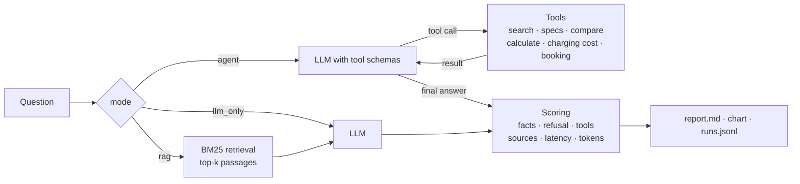

# agent-eval-lab

**Build and evaluate tool-using LLM agents against RAG and plain-LLM baselines.**

[](https://github.com/sandraesudhakaran-creator/agent-eval-lab/actions/workflows/ci.yml)
[](https://colab.research.google.com/github/sandraesudhakaran-creator/agent-eval-lab/blob/main/notebooks/colab_walkthrough.ipynb)

Before an AI use case goes live, someone has to answer a simple question: does the more complex setup actually work better, and at what cost? This project answers it in a measurable way. It runs the same test questions through three configurations and scores every answer:

| mode | what the model gets |
|---|---|
| `llm_only` | only the question |
| `rag` | the question plus the most relevant document passages (retrieval-augmented generation) |
| `agent` | the question plus tools it decides to call itself: document search, product data lookup, comparison, calculator, charging-cost estimate and a booking action |

Any model that speaks the OpenAI chat format can be plugged in:
- open models on a free Colab GPU via **Ollama**
- **Groq**, **OpenAI** or **Gemini**
- any other OpenAI-compatible endpoint

The demo domain is a customer assistant for **Velora Motors, a fictional electric-car maker**. It has six policy documents and a product table, all invented for this project. The domain is only a test bed: the agent, tools and evaluation work with any document folder and any set of Python functions.

## What it shows

- **An agent written from scratch, without a framework.** About 100 lines implement the full tool-calling loop:
  - the model requests tools, the code runs them and feeds the results back
  - a step limit, then a final answer without tools
  - every model call and tool call is recorded with latency and tokens
- **Tools from plain Python functions.** JSON schemas are generated from type hints and docstrings. Tool errors are returned to the model as text, so it can correct itself instead of crashing.
- **Retrieval.** Markdown is chunked along its headings, then ranked with BM25. This is explainable and needs no model download; a vector retriever can replace it through the same interface.
- **Evaluation harness.** 28 test cases in 7 categories:
  - document lookup
  - product data
  - comparison
  - calculation
  - multi-step questions that combine documents, data and maths
  - actions
  - questions that cannot be answered from the data, to catch hallucinations
- **Transparent scoring.** Every failed case lists the reason. The scores cover:
  - expected facts and forbidden content
  - correct refusals
  - tool recall and tool precision, and the correctness of action arguments
  - source recall
  - latency and token cost

  An optional LLM-as-judge adds a second opinion.
- **Robustness for small models.** If a model writes a tool call as JSON text instead of using the native tool field, the call is recovered. Rate limits are retried with back-off.

## Results

> **TODO: fill in after running the Colab notebook (section 8).** Replace every `…` with the measured value. Do not keep any placeholder.

| model | mode | pass rate | tool recall | tool precision | refusal accuracy | mean latency | mean tokens |
|---|---|---:|---:|---:|---:|---:|---:|
| qwen2.5:7b | llm_only | … | – | – | … | … | … |
| qwen2.5:7b | rag | … | – | – | … | … | … |
| qwen2.5:7b | agent | … | … | … | … | … | … |
| llama3.1:8b | llm_only | … | – | – | … | … | … |
| llama3.1:8b | rag | … | – | – | … | … | … |
| llama3.1:8b | agent | … | … | … | … | … | … |

Add `docs/img/pass_rate_by_category.png` and 2–3 sentences on what you observed: where the agent helps, where it fails, and what it costs in latency and tokens.

**Baseline without an LLM.** This one is measured, and CI runs it on every push. The extractive baseline returns the best-matching passage.

| run | pass rate | what it shows |
|---|---:|---|
| baseline, `llm_only` | 11 % (3/28) | It always says it doesn't know, which passes only the 3 unanswerable cases |
| baseline, `rag` | 39 % (11/28) | Retrieval alone answers all 10 document questions, but nothing that needs product data, maths or an action |

Any LLM configuration has to beat these numbers to justify its cost.

## How it works



**The agent loop** (`src/agentlab/agent.py`):
1. Send the conversation and the tool schemas to the model.
2. If the model asks for tools, run them and append each result as a `tool` message. Go back to step 1.
3. When the model answers without a tool call, that is the result.
4. After `max_steps` rounds, ask the model once more, without tools, to answer with what it has.

**Scoring** (`src/agentlab/evaluation.py`):
- **Answerable cases** pass when all expected facts appear in the answer, nothing forbidden appears, action arguments match and no error occurred. Numbers match regardless of formatting, so 1,190 = 1.190 = 1190.
- **Unanswerable cases** pass only when the answer says the information isn't available and invents nothing.

Rules were chosen over an LLM judge as the primary metric because they are reproducible and every verdict can be traced to a reason.

## Quick start

```bash
pip install -e ".[dev]"

# no LLM needed
agentlab eval --provider extractive --out outputs/baseline

# local open model (Ollama running, model pulled)
agentlab ask "What does it cost to charge a Ridge from 20 to 80 %?" --model qwen2.5:7b --trace
agentlab eval --model qwen2.5:7b --model llama3.1:8b --out outputs/open_models

# hosted model
export GROQ_API_KEY=...
agentlab eval --provider groq --model llama-3.3-70b-versatile --out outputs/groq

# any OpenAI-compatible endpoint
AGENTLAB_API_KEY=... agentlab eval --base-url https://my-endpoint/v1 --model my-model

pytest
```

Each eval run writes:
- `report.md`: overall table, per-category table and failed cases with reasons
- `pass_rate_by_category.png`
- `summary.json`
- `runs.jsonl`: every answer with its full step-by-step trace

## Adapting it to another use case

1. Put your documents as Markdown into a folder, and load them with `load_markdown_dir`.
2. Write your tools as typed Python functions with docstrings and register them with `@registry.tool`.
3. Write test cases in YAML: the question, the expected facts, any forbidden content, the expected tools and sources.
4. Run `agentlab eval` and compare models and modes.

## Project structure

```
src/agentlab/
  llm.py         OpenAI-compatible client, extractive baseline, scripted test model
  tools.py       tool registry: schemas from type hints, safe execution
  rag.py         Markdown chunking and BM25 retrieval
  agent.py       llm_only, RAG and tool-calling agent, with traces
  demo.py        fictional Velora domain: tools and prompts
  evaluation.py  test cases, scoring, aggregation
  report.py      Markdown report and chart
  cli.py         agentlab ask / agentlab eval
data/            knowledge base, product table, evaluation cases (all fictional)
tests/           35 tests, including a local fake OpenAI server for the HTTP client
```

## Limitations

- The test set is small: 28 cases, so one case is about 3.6 % of the pass rate. Differences of one or two cases are not meaningful.
- Fact matching is string-based. A correct answer phrased unusually can fail, and the per-case reasons in the report make this visible. The optional LLM judge gives a second opinion.
- BM25 matches keywords, not meaning. Paraphrased questions with no shared words can miss the right passage.
- The booking tool is a mock and the data is fictional. Nothing here connects to a real system.

## Licence

MIT. Velora Motors and all its data are fictional.
